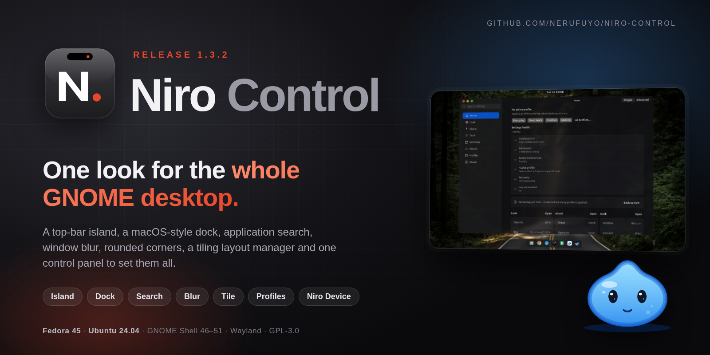
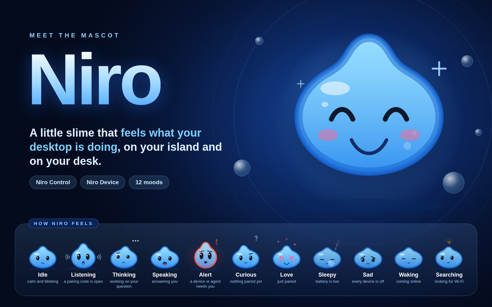
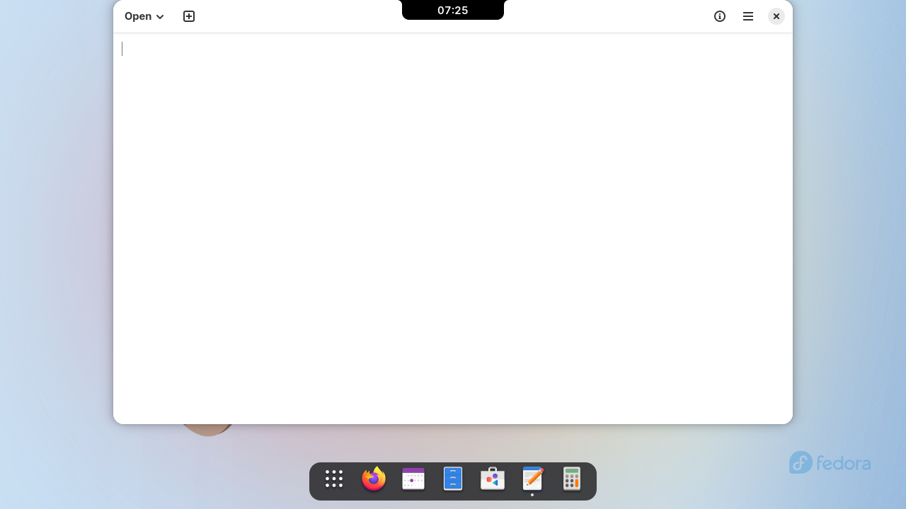
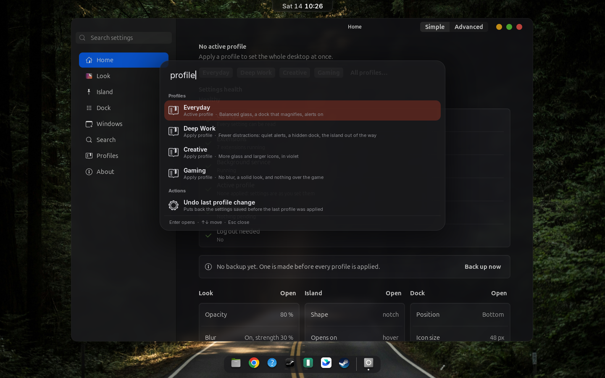
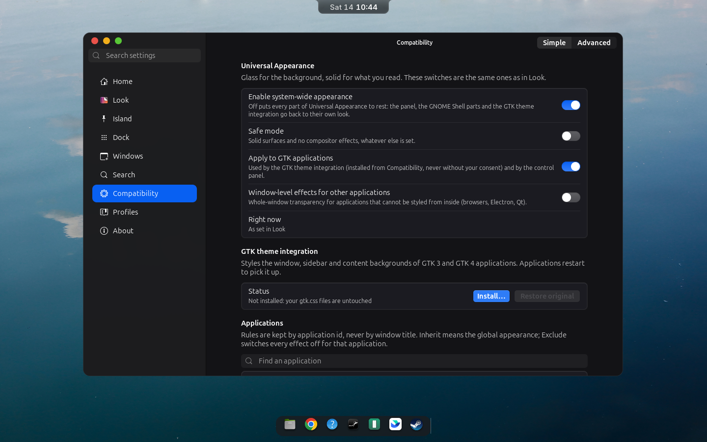

# Niro Control: GNOME Shell extensions for Fedora and Ubuntu

<p align="center"></p>

**Niro Control is a suite of GNOME Shell extensions that gives the whole desktop one look.** A top-bar island, a macOS-style dock, a Spotlight-like application search (`Super+Space`), window blur and
rounded corners, a tiling window manager (layout manager), an emoji picker, and a control panel that sets them all from one place. One repository, one package.

Runs on **Fedora 45 (GNOME Shell 51)** and **Ubuntu 24.04 (GNOME Shell 46)**, on Wayland. The extensions declare GNOME Shell 46 to 51.
Packages: `.rpm` for Fedora, `.deb` for Ubuntu and Debian. Both are built from the same tree. Current version: **1.6.0** ([releases](https://github.com/nerufuyo/niro-control/releases)).

Jump to: [Install](#install) · [Screenshots](#screenshots) · [What you get](#what-you-get) · [Updating](#updating)

## What you get

| Part | What it does |
|---|---|
| **Island** | A notch on the top bar that opens into music with synced lyrics, calls, a focus timer and a stopwatch with laps, quick controls (thick volume and brightness sliders, Wi-Fi with its password asked on the spot, Bluetooth, Night Light…), reminders, a clipboard and file shelf, calendar, notifications, system stats, a battery card for laptops with the power mode and session controls, AI usage (Claude, ChatGPT Plus or Pro, Grok and an opencode Go plan through their sign-ins, and the balance of a DeepSeek API account with its key, every provider in its own column so all the numbers are in view at once), alerts when Claude Code, Codex or opencode needs you or is done, and a voice assistant. Alerts for volume, battery, Bluetooth, meetings and more. |
| **Dock** | A dock with icon magnification, window previews, genie minimise (a pinned app's window becomes a thumbnail at the dock's end as on macOS, an unpinned app's icon becomes its overview), running indicators, unread-notification counts on app icons, Downloads and Documents stacks at its end (a click lists the newest files; a bar pulses under Downloads while a download is being written; a Trash stack with a two-click Empty, and a folder stack of your choice; the memory an app holds shows in its tooltip), an app's own actions in its right-click menu ("New Private Window"…), auto-hide (also over full-screen apps, brought back by the screen edge) four positions, and its size and icons your own: icon size, spacing and padding, any installed icon theme, tiles (rounded, circle, glass), muted or grey icons. |
| **Search** | `Super+Space`: a command palette for applications, a calculator, unit and time zone conversion (`jam di tokyo`, `10:00 jakarta to london`), currency (`150 usd to idr`; only the two currency codes are sent, to [Frankfurter](https://frankfurter.dev)'s ECB rates, kept for six hours), open windows, files by name (`f invoice`; names only, on this computer), dates (`30 days from now`, `selisih 1 jan ke 17 agu`), a passwords and ids generator (`pass 20`, `uuid`), translation (`tr id good morning`) and word meanings (`define serendipity`) (the words typed go to MyMemory and dictionaryapi.dev), weather (`cuaca bandung`; the city name goes to Open-Meteo), world clocks (`world`), QR codes (`qr text`), notes, to-dos and habits kept as plain files in Documents/Niro (`note`, `todo`, `habit`), the next events of the island's calendar (`next`), your terminal history (`h docker`), words inside files (`fc invoice`), stopping a process (`kill zoom`, asks first), window layouts by name (`layout save work`, `layout work`), Home Assistant lights and switches (`ha light`; your own server, the token in `~/.config/niro-control/ha-token`), autostart entries (`autostart`), and, under Search › Search Behaviour in the panel, an opt-in suggestion of a profile for the application in front (Search shows one row, Enter applies it, nothing happens by itself), whether tools come above applications, which cities `world` shows, the language of dates and weather (English or Indonesian), the days of forecast, and what `kill` never offers; and a window switcher with a live picture of every window on a shortcut of your own (off until you set one; Alt+Tab is not changed), base64 and hashes (`b64 text`, `sha256 text`), a calculator that remembers names (`gaji = 8jt`, then `gaji * 12`; `ans` is the last result), every Niro setting, profiles, system actions (lock, Do Not Disturb, presentation mode, VPN, battery health, network speed, empty the trash, screen recorder, magnifier, pointer spotlight, keep a window on top, Wi-Fi, Bluetooth, mute, Night Light, screenshot, suspend, log out…) and the island's clipboard history. Eleven opt-in switches under Search › System Experience (all off) add actions to that registry: clean secrets and old items out of the clipboard history, notification rules with snooze and quiet hours, performance readings and a numbers-only export, a privacy overview (microphone, camera, screen sharing), per-application volume and output, a message in GNOME's on-screen display, named shelf collections of references, and a short list of widgets (processor, memory, load, battery) in Search results. One typed action registry, also on D-Bus. |
| **Niro Snip** | `Super+Shift+S`: a screenshot (the desktop's own area / window / screen picker) opened in an editor: pen, highlighter, arrow, rectangle, text, numbered steps, pixelate to hide what is private, and crop. A button copies the text in the picture (OCR, needs `tesseract`), and another hides e-mail addresses, phone and card numbers and keys it finds (pixelated, undo removes them). Also a ruler, a colour picker, a frame (gradient, rounded corners, shadow), an optional history of snips (`snips` in Search) and an optional upload to an address of your own. Save writes over the screenshot and copies it; Save As keeps a copy; Copy & close (`Ctrl+Enter`). `niro-snip --delay 5` waits first, `niro-snip --full` takes the whole screen, `niro-snip FILE` edits any picture. |
| **Window blur** | Frosted glass behind application windows, with one strength and opacity for everything. |
| **Rounded corners** | Round corners and shadows for every window, including Chrome and Electron apps. |
| **Tile** | A window layout manager for GNOME, off until you switch it on (`Super+Alt+G`): ten layouts (Dwindle, Master left/right, Center master, Grid, Three columns, Horizontal and Vertical split, Scrolling, Monocle), a layout for each workspace and monitor, rules per application (float, tile, send to a workspace), a quick switcher (`Super+Alt+Space`), directional focus and swap, drag a window to a cell of the layout shown as a preview, resize by pulling an edge, profiles, and the `niro-tile` command line. The panel's Tiling module has Overview, Layouts, Workspaces, Window Rules, Appearance, Shortcuts, Monitors, Profiles and Advanced. |
| **Emoji, Emulator** | An emoji picker on `Super+.` or `Super+;` with every emoji, 179 kaomoji and about 1,100 text symbols (arrows, maths, Greek, currency, box drawing, accents…), searched by name in English or Indonesian, with its settings in the panel's Search page; keeps the Android Emulator window on top. |
| **Profiles** | Save the whole desktop as a profile and switch with one action: four built-ins (Everyday, Deep Work, Creative, Gaming), preview before applying, backups, rollback, import and export. |
| **Niro Device** | An ESP32-S3 assistant with a small screen that belongs to one user's Niro: paired with a 6-digit code (it is never sent over the network), then connected over the same Wi-Fi with every frame sealed. It shows notifications and Niro's face. Firmware in [`firmware/niro-device`](firmware/niro-device/README.md), protocol in [`docs/device-protocol.md`](docs/device-protocol.md); the island has a page for it (off until you switch it on in Settings → Island). Ask it out loud: say "Momo Niro" and your question (the computer turns speech into words with Whisper, nothing is kept), or hold its button; it answers on screen and through its speaker. |
| **Niro Control** | The control panel: a Home dashboard, Simple and Advanced modes, a sidebar with search over all 243 settings, live previews of the look, dock and windows, a shortcut recorder that refuses clashes, per-setting reset, and a light-by-day, dark-by-night schedule and Do Not Disturb hours (Look). A reminder ending in `/daily`, `/weekdays`, `/weekly` or `/monthly` comes back by itself. |

Opacity, blur, blur strength, accent and tint are set once, in **Look**, and the island, dock, search and windows follow.
Light and dark appearance both work, and the panel adapts to narrow windows.

## Niro, the mascot

<p align="center"></p>

Niro is a small slime (a nod to Rimuru's slime form) that lives in two places and means the same thing in both:

- **On the Niro Device's screen**, with its own face for each state: idle, listening, thinking, speaking, happy, alert, sleepy, sad, curious, love, plus waking and searching for Wi-Fi. The daemon can set the mood with `Devices1.Face`. It is drawn by the firmware (anti-aliased, with a jelly body) and previewed on a PC with `firmware/niro-device/test/host`.
- **In the island**, on the Niro Device page, where it mirrors your real device: curious with no device, listening while a pairing code is open, alert when a device asks to join, in love for a moment once paired, happy when it comes online, sad when every device is off, sleepy when the battery is low. Poke it and it boings. It is also a ninth **Slime** shape for the island's assistant (Settings → Assistant → Shape; best in colour Sky).

It costs nothing when it is not in view: no frames and no timers while the island is closed or the page is off, and under 1% of a core while it is on screen and calm. Notes on how it is drawn and tested are in [`firmware/niro-device/MASCOT.md`](firmware/niro-device/MASCOT.md).

## Screenshots

The island alone at the top (GNOME's top bar is taken away; windows use the whole screen), with the dock below:



Taken from a headless GNOME Shell with the installed package (`scripts/screenshots.sh` regenerates them).

| Home and Settings Health | Profiles |
|---|---|
|  |  |
| **Look** | **Search: settings** |
|  |  |
| **Search: calculator** | **Search: profiles** |
|  |  |

## Universal Appearance

One shared look with glass for backgrounds and solid text: presets, safe mode, a global switch, per-application rules and an opt-in GTK theme integration (never installed without your consent, always restorable). See [docs/APPEARANCE.md](docs/APPEARANCE.md) for what reaches which application, and what is only documented, not tested.

| Compatibility | GTK apps with the integration (Files, Settings) |
|---|---|
|  |  |

## Install

On **Fedora**, from the package repository (the quickest, and it keeps you up to date; see [Updating](#updating) for what to know about it):

```sh
sudo curl -o /etc/yum.repos.d/niro-control.repo https://nerufuyo.github.io/niro-control/niro-control.repo
sudo dnf install niro-control
```

Or build it from this repository (Fedora and Ubuntu/Debian):

```sh
git clone https://github.com/nerufuyo/niro-control.git
cd niro-control
make deps           # build tools and libraries from your distribution (asks for sudo)
make install        # builds the package for this system (.rpm on Fedora, .deb on Ubuntu/Debian) and installs it
```

Log out and in to load the extensions (or run `make activate`: it logs you out for you after a countdown and, once you are back, checks by itself and tells you in a notification), then open **Niro Control** from the applications menu (or run `niro-control`).
`make rpm` or `make deb` only builds the package, into `out/`.

`niro-doctor` (installed with the package) reports whether the eight parts are active in this session, the daemon, the icon and the dock's pin; `niro-doctor --relogin` logs you out when the shell has not loaded Niro yet (and, when GDM is set to log you in by itself, restarts GDM after the logout so you come back without the password: GDM's own timed login does not log anyone in after a logout), `niro-doctor --pin` pins it to the dock.

What `make deps` installs, if you prefer to do it by hand:

| | Fedora | Ubuntu / Debian |
|---|---|---|
| Rust 1.88+, C/C++ compiler | `rust cargo gcc gcc-c++` | `build-essential`, Rust from [rustup](https://rustup.rs) |
| Speech recognition (island-whisper) | `cmake clang-devel vulkan-loader-devel glslc` | `cmake libclang-dev libvulkan-dev glslc` |
| Island shelf window | `gtk4-devel libadwaita-devel glib2-devel` | `libgtk-4-dev` |
| Control panel and extensions | `nodejs npm gjs dconf` | `nodejs npm gjs dconf-cli` |
| Packaging | `rpm-build cpio` | `dpkg-dev cpio` |
| System tray icons, user themes | `gnome-shell-extension-appindicator gnome-shell-extension-user-theme` | `gnome-shell-extensions gnome-shell-extension-appindicator` |

Node 20+ is needed. The first build compiles whisper.cpp and takes a few minutes. Without `glslc` the speech recognition is
built for the CPU only.

On Fedora, if the extensions do not show up after logging in, enable them once: `gnome-extensions enable dock@niro.local`
(and `island@`, `search@`, `blur@`, `corners@`, `emoji@`, `emulator@`). The package sets them on by default through dconf.

## Updating

The island tells you when a newer version is out (Settings → Island → About; it asks GitHub for the latest release every six hours and sends nothing but the request; turn it off there). It never downloads or runs anything itself: it says where the new version is.

On **Fedora**, add the package repository once, then update like any package (GNOME Software shows it too):

```sh
sudo curl -o /etc/yum.repos.d/niro-control.repo https://nerufuyo.github.io/niro-control/niro-control.repo
sudo dnf install niro-control        # later: sudo dnf upgrade niro-control
```

To have Fedora install new versions by itself, turn on **Install updates automatically** in Settings → Island → About (off until you do; it asks for your administrator password once). That switches on a systemd timer, `niro-control-update.timer`, which once a day runs `dnf upgrade niro-control` and nothing else; turn it off the same way, or `sudo systemctl disable --now niro-control-update.timer`. It needs the repository above. Because the repository is unsigned (next paragraph), turn this on only if you trust the project's GitHub account.

The repository is **not signed yet** (the release scripts can sign it as soon as the maintainer makes a key, and the repo file then turns `gpgcheck` on): its packages are as trustworthy as the GitHub account that publishes them, the same as a package downloaded from the [releases](https://github.com/nerufuyo/niro-control/releases). Log out and back in after an update: GNOME Shell loads a new version of an extension only at login. On Ubuntu/Debian, download the `.deb` from the releases and open it.

## Repository layout

```
shell/island/   the island: GNOME Shell extension (TypeScript)         island@niro.local
shell/dock/     the dock (TypeScript)                                  dock@niro.local
shell/search/   application search (TypeScript)                        search@niro.local
shell/emulator/ Android Emulator window helper (TypeScript)            emulator@niro.local
shell/blur/     window blur (from Blur my Shell, GPL)                  blur@niro.local
shell/corners/  rounded corners (from Rounded Window Corners, GPL)     corners@niro.local
shell/emoji/    emoji picker (from Emoji Copy, GPL)                    emoji@niro.local
crates/         Rust programs behind the island: daemon, shelf window, speech recognition
firmware/       the Niro Device firmware (ESP-IDF, ESP32-S3) and its host tests
control/        the control panel (TypeScript on GJS) and the shared schema org.niro.control
data/           systemd unit, D-Bus services, fonts, dconf defaults
packaging/      the Debian package
tests/          node and GJS tests
docs/           maintenance notes, the island's guide and D-Bus API, the list of every panel setting
```

## Development

| | |
|---|---|
| `make test` | build the TypeScript; run the node tests, the GJS tests (every setting binds, writes and resets), and the Rust tests |
| `make test-shell` | a headless GNOME Shell against this checkout, no installed package needed: extensions load, search, appearance, blur rules, tiling, and the island's Controls and Power pages (with a stand-in `nmcli` and a battery the test sets) |
| `make test-dbus` | every D-Bus call the island makes against the real `island-daemon` |
| `make rpm` / `make deb` | build `out/niro-control-<version>-<commits>.<dist>.<arch>.rpm` / `out/niro-control_<version>+git<commits>_amd64.deb` |
| `scripts/set-version.sh X.Y.Z`, `scripts/release.sh` | raise the version in every place it is kept; publish a GitHub release with the RPM and the dnf repository (see [`docs/MAINTAINING.md`](docs/MAINTAINING.md)) |
| `make catalog` | regenerate the control panel's settings catalog from the schemas |
| `make lint` | check the dock's code with Biome |

`gsettings set org.niro.control opacity 70` does what the panel's slider does. See [`docs/MAINTAINING.md`](docs/MAINTAINING.md)
for how the parts talk to each other and where to change things.

## Status

A personal desktop project, shared as it is. Tested on Ubuntu 24.04 (GNOME 46, Wayland, NVIDIA) and Fedora 45 (GNOME 51, Wayland):
on Fedora, all eight extensions enable in a real headless GNOME Shell 51 and the node and GJS tests pass.
The Fedora `.rpm` is installed and used daily on the maintainer's Fedora 45 desktop. Not run on real hardware: a laptop battery, a Wi-Fi adapter and a screen backlight (the island's battery card, Wi-Fi list and brightness slider were tested with stand-ins), opencode itself (its alerts and its Go-plan limits were tested against the same messages and a local server, not against a real opencode), and the Ubuntu package since the Fedora work began. The Niro Device's pairing, reconnection and notifications have run on a real board; its mascot firmware and the island's Niro Device page were tested on a PC and in a headless Shell, not yet on the board's own panel. `docs/UAT.md` is the checklist for a full session.
The island's TypeScript still carries `// @ts-nocheck`: converted from JavaScript, to be typed file by file.

## Credits and licence

GPL-3.0-or-later ([`LICENSE`](LICENSE)). The island and the dock started as forks of
[zickrian/isle](https://github.com/zickrian/isle) (GPL-3.0) and
[vinnytherobot/MacOSDock](https://github.com/vinnytherobot/MacOSDock) (MIT, [`shell/dock/LICENSE`](shell/dock/LICENSE)).
`shell/blur`, `shell/corners` and `shell/emoji` are copies of [Blur my Shell](https://github.com/aunetx/blur-my-shell),
[Rounded Window Corners Reborn](https://github.com/flexagoon/rounded-window-corners) and
[Emoji Copy](https://github.com/felipeftn/emoji-copy), all GPL-3.0, with their licences. The application search and the
control panel are new. The Inter font is under the SIL OFL ([`data/fonts/Inter-LICENSE.txt`](data/fonts/Inter-LICENSE.txt)).
Their copyright notices are kept in the files.
