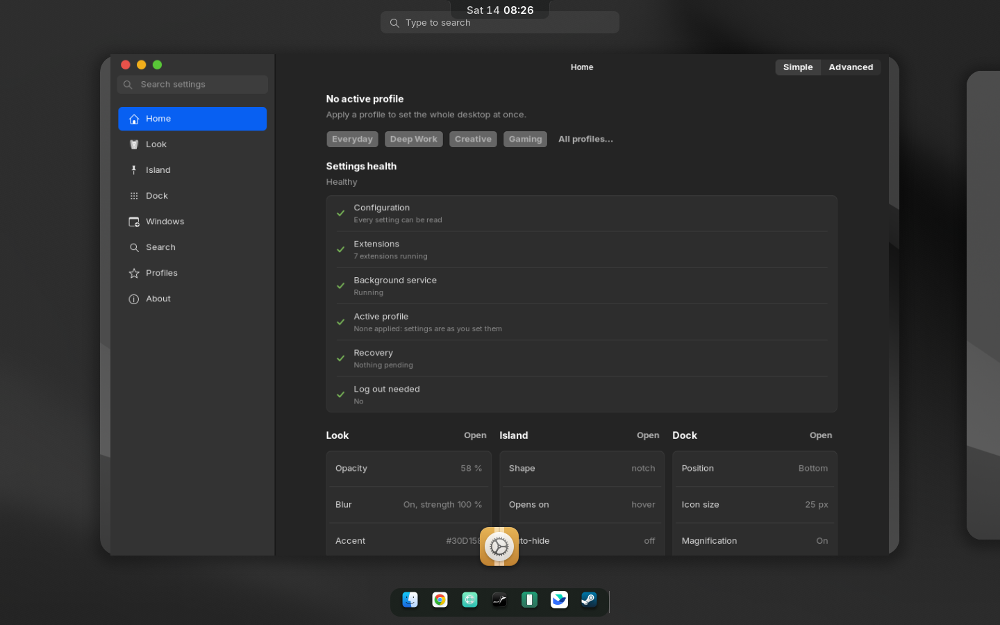
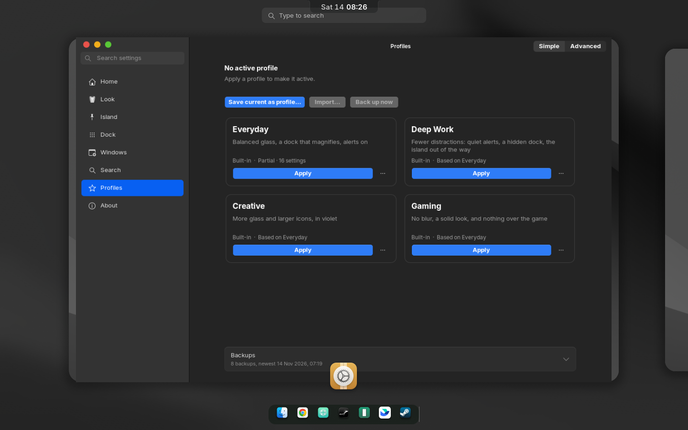
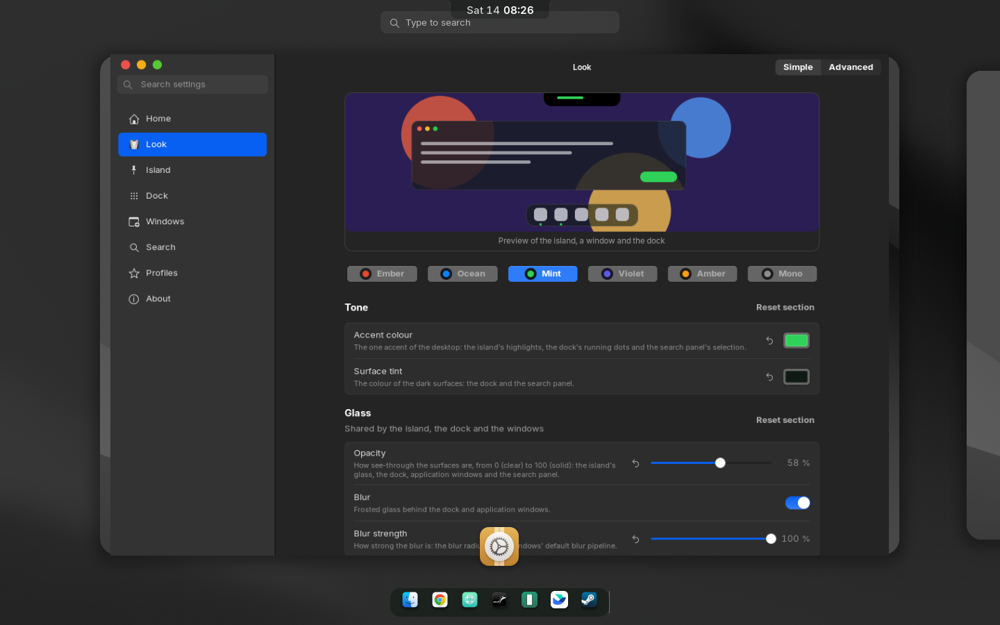
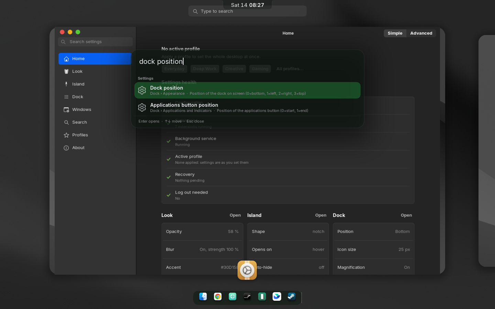
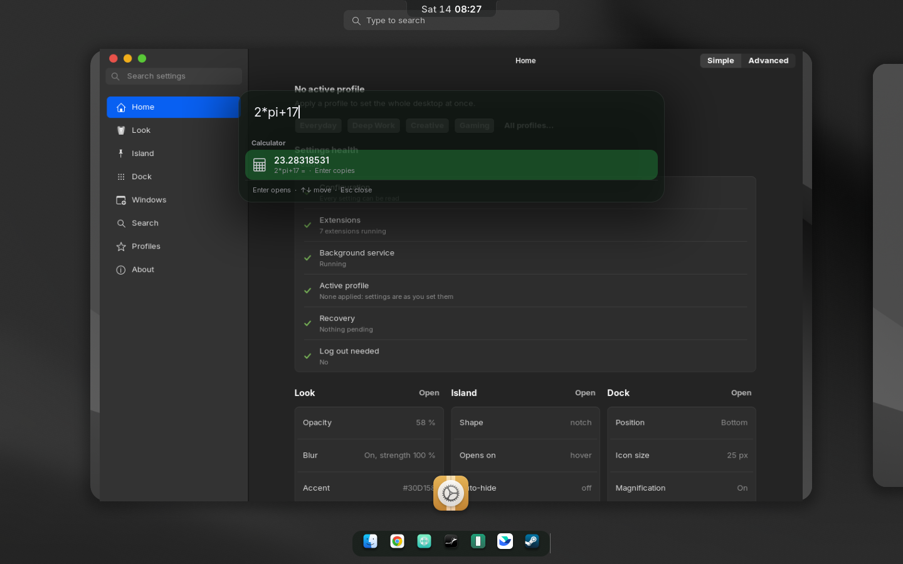
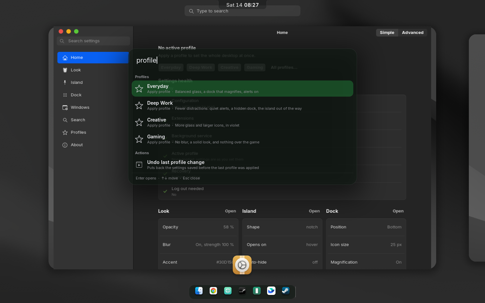

# Niro Control

**One look for the whole GNOME desktop.** A top-bar island, a macOS-style dock, an application search, window blur and
rounded corners, and a control panel that sets them all from one place. One repository, one `.deb`.

Built for **Ubuntu 24.04 / GNOME Shell 46** (Wayland). The extensions declare support for newer shells, but only 46 is tested.

## What you get

| Part | What it does |
|---|---|
| **Island** | A notch on the top bar that opens into music with synced lyrics, calls, a focus timer, reminders, a clipboard and file shelf, calendar, notifications, system stats, power controls, AI plan usage, and a voice assistant. Alerts for volume, battery, Bluetooth, meetings and more. |
| **Dock** | A dock with icon magnification, window previews, genie minimise, running indicators, auto-hide and four positions. |
| **Search** | `Super+Space`: a command palette for applications, a calculator, unit conversion, open windows, every Niro setting, profiles, system actions (lock, Do Not Disturb, suspend, log out…) and the island's clipboard history. One typed action registry, also on D-Bus. |
| **Window blur** | Frosted glass behind application windows, with one strength and opacity for everything. |
| **Rounded corners** | Round corners and shadows for every window, including Chrome and Electron apps. |
| **Emoji, Emulator** | An emoji picker; keeps the Android Emulator window on top. |
| **Profiles** | Save the whole desktop as a profile and switch with one action: four built-ins (Everyday, Deep Work, Creative, Gaming), preview before applying, backups, rollback, import and export. |
| **Niro Control** | The control panel: a Home dashboard, Simple and Advanced modes, a sidebar with search over all 132 settings, live previews of the look, dock and windows, a shortcut recorder that refuses clashes, and per-setting reset. |

Opacity, blur, blur strength, accent and tint are set once, in **Look**, and the island, dock, search and windows follow.
Light and dark appearance both work, and the panel adapts to narrow windows.

## Screenshots

Taken from a headless GNOME Shell with the installed package (`scripts/screenshots.sh` regenerates them).

| Home and Settings Health | Profiles |
|---|---|
|  |  |
| **Look** | **Search: settings** |
|  |  |
| **Search: calculator** | **Search: profiles** |
|  |  |

## Install

```sh
git clone https://github.com/nerufuyo/niro-control.git
cd niro-control
make install        # builds the package and installs it with dpkg
```

Log out and in to load the extensions, then open **Niro Control** from the applications menu (or run `niro-control`).

To build: Node 20+, a Rust toolchain, and `libgtk-4-dev`. For the voice assistant's speech recognition also `cmake`, a C++
compiler and `libclang-dev` (and `libvulkan-dev` with `glslc` for GPU support). The first build compiles whisper.cpp and takes a
few minutes.

## Repository layout

```
shell/island/   the island: GNOME Shell extension (TypeScript)         island@niro.local
shell/dock/     the dock (TypeScript)                                  dock@niro.local
shell/search/   application search (TypeScript)                        search@niro.local
shell/emulator/ Android Emulator window helper (TypeScript)            emulator@niro.local
shell/blur/     window blur (from Blur my Shell, GPL)                  blur@niro.local
shell/corners/  rounded corners (from Rounded Window Corners, GPL)     corners@niro.local
shell/emoji/    emoji picker (from Emoji Copy, GPL)                    emoji@niro.local
crates/         Rust programs behind the island: daemon, shelf window, speech recognition
control/        the control panel (TypeScript on GJS) and the shared schema org.niro.control
data/           systemd unit, D-Bus services, fonts, dconf defaults
packaging/      the Debian package
tests/          node and GJS tests
docs/           maintenance notes, the island's guide and D-Bus API, the list of every panel setting
```

## Development

| | |
|---|---|
| `make test` | build the TypeScript; run the node tests, the GJS tests (every setting binds, writes and resets), and the Rust tests |
| `make deb` | build `out/niro-control_<version>+git<commits>_amd64.deb` |
| `make catalog` | regenerate the control panel's settings catalog from the schemas |
| `make lint` | check the dock's code with Biome |

`gsettings set org.niro.control opacity 70` does what the panel's slider does. See [`docs/MAINTAINING.md`](docs/MAINTAINING.md)
for how the parts talk to each other and where to change things.

## Status

A personal desktop project, shared as it is. It is tested on one machine (Ubuntu 24.04, GNOME 46, Wayland, NVIDIA).
The island's TypeScript still carries `// @ts-nocheck`: converted from JavaScript, to be typed file by file.

## Credits and licence

GPL-3.0-or-later ([`LICENSE`](LICENSE)). The island and the dock started as forks of
[zickrian/isle](https://github.com/zickrian/isle) (GPL-3.0) and
[vinnytherobot/MacOSDock](https://github.com/vinnytherobot/MacOSDock) (MIT, [`shell/dock/LICENSE`](shell/dock/LICENSE)).
`shell/blur`, `shell/corners` and `shell/emoji` are copies of [Blur my Shell](https://github.com/aunetx/blur-my-shell),
[Rounded Window Corners Reborn](https://github.com/flexagoon/rounded-window-corners) and
[Emoji Copy](https://github.com/felipeftn/emoji-copy), all GPL-3.0, with their licences. The application search and the
control panel are new. The Inter font is under the SIL OFL ([`data/fonts/Inter-LICENSE.txt`](data/fonts/Inter-LICENSE.txt)).
Their copyright notices are kept in the files.
