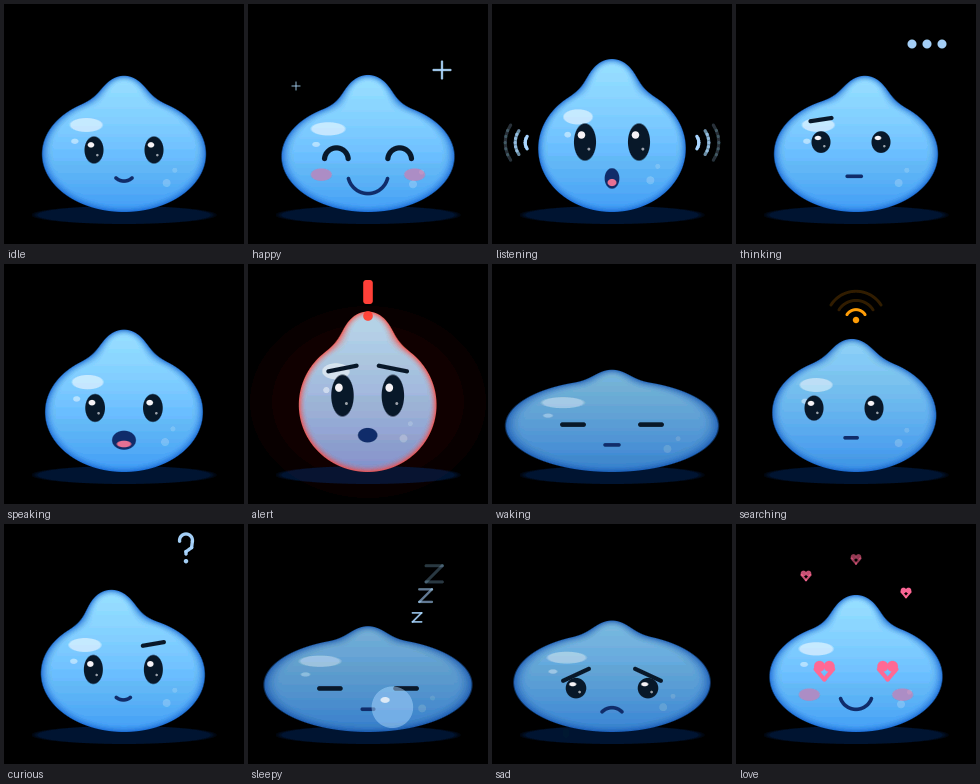
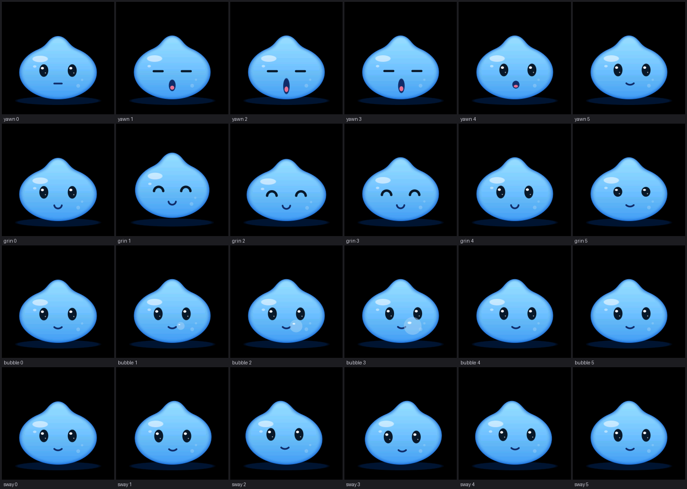

# Niro, the mascot

A little blue slime that lives on the device's screen and feels what the device is doing. It is drawn in code, not from
pictures, so it can squash, stretch and wobble like jelly, change its face smoothly, and do something of its own now and then:
the same character every time, never quite the same moment.



The look is a soft teardrop, lighter on top and deeper below, a darker rim, a glossy highlight, two shiny black eyes and a small
mouth, in Niro's blue so it sits with the island. It was made to resemble a slime in its basic form, drawn from the shape alone.

## Moods

An expression is a *pose*: a few numbers (how wide and tall the body is, how big the eyes are, how the brows tilt, how the
mouth curves). The face eases toward a new pose, so a change is a transition, never a cut.

| Mood | When the device shows it | What it looks like |
|---|---|---|
| `idle` | connected and calm | blinks, looks about, now and then acts (below) |
| `happy` | connected; paired; a message | smiling eyes, a wide smile, a blush, hops, sparkles |
| `listening` | the daemon says so | taller, wide eyes, a small round mouth, sound waves |
| `thinking` | waiting for you to allow it; the daemon says so | looks up, a raised brow, three dots |
| `speaking` | the daemon says so | the mouth opens and closes, a little bounce |
| `alert` | an urgent notification | tall, wide eyes, worried brows, red rim and glow, a shiver, a `!` |
| `curious` | not paired yet | head leans, one brow up, a `?` |
| `sad` | offline; a wrong code; refused | droops, brows up, a tear |
| `sleepy` | left alone for a minute and a half | melts low, eyes shut, a bubble at the nose, Zs |
| `love` | the daemon says so | hearts for eyes, a blush, a gentle bob |
| `waking` | boot | rises from a puddle and opens its eyes |
| `searching` | looking for Wi-Fi or for your PC | eyes sweep left and right, a signal that fills in |

The daemon can set `idle`, `listening`, `thinking`, `speaking`, `happy`, `alert`, `sleepy`, `sad`, `curious` and `love` by name
(`Devices1.Face`, or a `face` message); `waking` and `searching` are the device's own.

## Alive

- **Jelly body.** The body is a spring: it squashes when it lands, stretches going up, wobbles after a knock, and keeps its volume
  (wider means lower). A shadow shrinks as it leaves the ground.
- **Blinks** at random, now and then twice. **Looks about** by itself while calm.
- **Idle acts**, one every 8 to 20 seconds, picked at random: a yawn, a wink with either eye, a look around, a grin with a hop,
  a bubble blown at the mouth, a sway.
- **Dozes off** after a minute and a half with nothing happening, and wakes when anything does.
- It reacts first to a notification (alert for an urgent one, happy for another), then shows its words.



## How it is made

`main/draw.c` draws every shape as a signed distance field and blends the pixels on its edge by how much of them the shape covers,
so the edges are smooth on a 240 × 240 screen. `main/face.c` holds the poses, the spring and the idle behaviour; `main/face_task.c`
runs it about 30 times a second and owns the screen while the face is shown, giving it up for the code entry and a notification's text.

Both files are plain arithmetic, so they run on the PC too, and that is how the face was designed, by looking at it:

```sh
gcc -O2 -o face_preview firmware/niro-device/test/host/face_preview.c firmware/niro-device/main/face.c \
    firmware/niro-device/main/draw.c -Ifirmware/niro-device/main -lm
./face_preview sheet /tmp/face && python3 firmware/niro-device/test/host/face_sheet.py sheet /tmp/face /tmp/moods.png
./face_preview act /tmp/face/a 1 6      # one idle act, six frames (1 yawn, 2 and 3 winks, 4 look, 5 grin, 6 bubble, 7 sway)
./face_preview bench                    # how long a frame takes to draw, here
```

(`face_sheet.py` needs Pillow.) `test/host/face_test.c` draws every mood for a minute of animation, many times over, in a buffer with
guard words around it, and fails if a pixel strays out of the canvas or a mood draws almost nothing.

## To add a mood

Add it to `face_mood_t` in `face.h`, give it a pose in `pose_for` in `face.c` (and anything extra it draws in the `switch` at the end of
`face_draw`), add its name to `face_name`, and look at it with `face_preview sheet`. To send it from the daemon, add the name to the `Face`
enum in `crates/island-daemon/src/device/proto.rs`.

## In the island

The same slime lives in the island, drawn with Cairo from the same poses and the same spring (`shell/island/src/slime.ts`, `slimeDraw.ts`,
`slimeView.ts`). It follows the island's own rule for its characters, to cost nothing while it is still:

- **On the Niro Device page** it sits beside the list and shows what is paired: curious with no device, listening while a code is open, alert
  (red) while a device asks to be allowed, in love for a moment when one is paired, happy when one comes online, sad when they are all away,
  sleepy when a battery is low, calm otherwise. Poke it and it boings.
- **As a look for the assistant**: Settings → Assistant → Shape → *Slime* (with the colour *Sky* it is Niro's blue). The bot then wears it wherever
  it appears, with the island's own gestures.

It draws only while it moves: a calm slime is asleep between its blinks and acts, one that is not on screen (the page is not shown, the island is
closed) draws nothing and wakes no timer, and with animations off in GNOME it holds still. Measured in a headless GNOME Shell: with the page open
and the slime calm, about 9 frames a second at 0.9 ms each (under 1% of one core); with the island closed, no frames and no wake-ups.

## What is not known yet

- How fast it runs **on the board**. On the PC a frame draws in about 0.2 ms; the ESP32-S3 has no hardware square root or division, so it
  will be far slower, and the figure has not been measured. The firmware logs `face: N fps, drawing a frame takes M ms` every five seconds.
- How it **looks in a real session**: the island was seen in a headless GNOME Shell, not on your screen; and how it looks on the board's panel: the panel's colours, contrast and orientation (see the README). The pictures above are the PC's.
