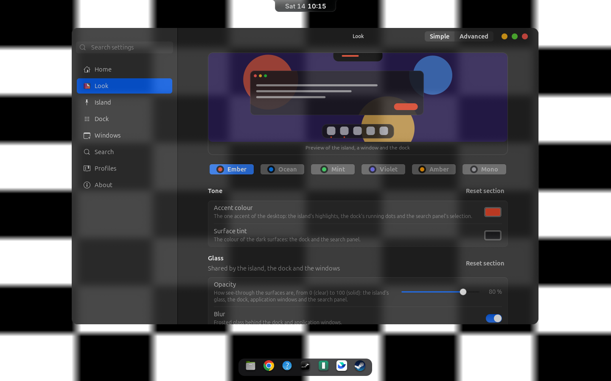
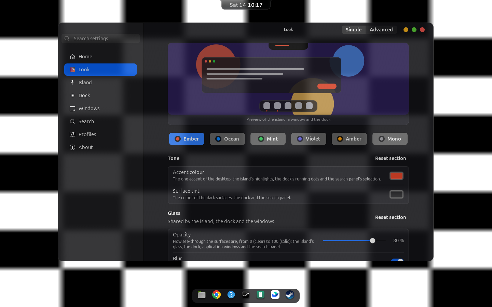
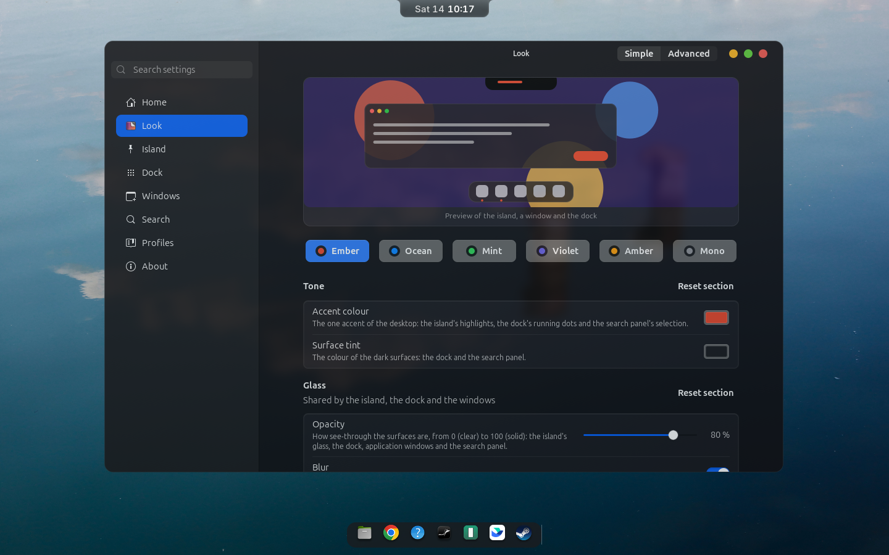
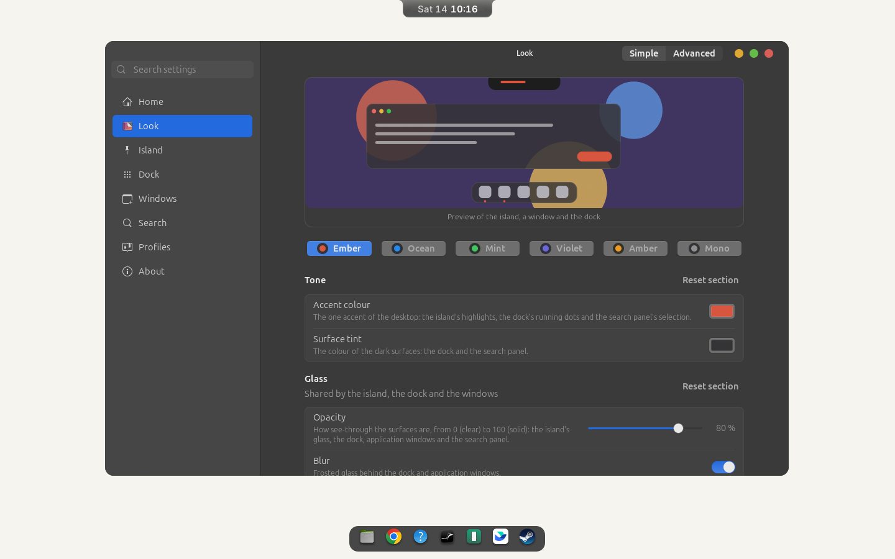
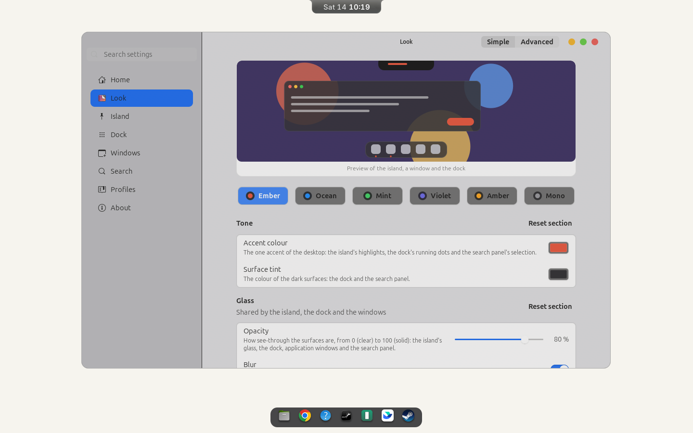

# Panel glass: before and after

Headless GNOME Shell, 1440x900, the Look page, Simple mode, opacity 80 (the default). "Before" is commit `a64786c` with the installed blur extension (which fades the whole window by the Look opacity); "after" is the layered styling with the repository's blur extension. Over a checkerboard (the worst case for text over glass):

| Before | After |
|---|---|
|  |  |
|  |  |
|  |  |

`after/` holds the whole matrix: `<scheme>-<opacity>-<wallpaper>.png`. These are screenshots of a private headless shell: they are not a check of your own session.
